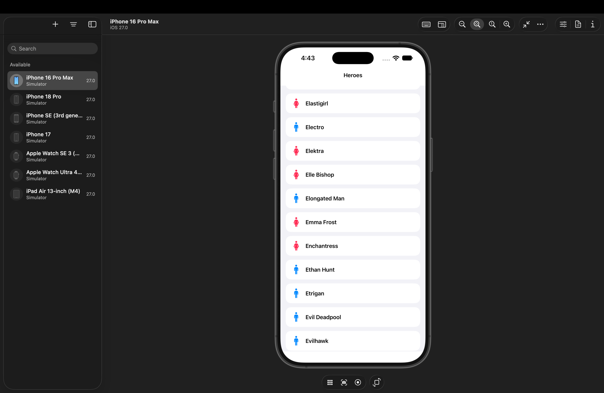
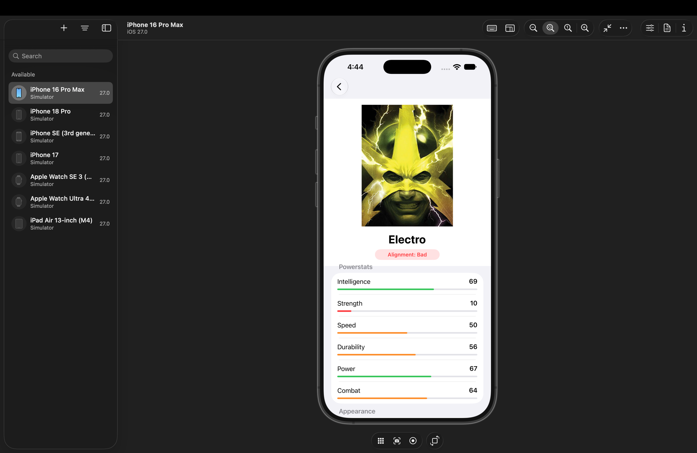
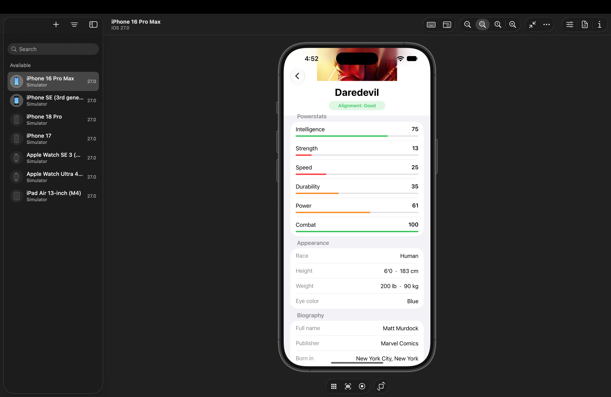

# HeroApp: Superheroes List & Detail

An iOS app (UIKit, storyboard) that downloads superheroes from a real API and shows them in a list. Tapping a hero opens a detail page with the picture and its stats. The data comes from the public [Superhero API](https://akabab.github.io/superhero-api/) and is loaded with `URLSession`.

## Screenshots

| List | Detail: Electro | Detail: Daredevil |
|---|---|---|
|  |  |  |

## Chosen properties (16, from 4 groups)

| Group | Property | How it is presented |
|---|---|---|
| Powerstats | Intelligence | Label with the number plus a progress bar |
| Powerstats | Strength | Label with the number plus a progress bar |
| Powerstats | Speed | Label with the number plus a progress bar |
| Powerstats | Durability | Label with the number plus a progress bar |
| Powerstats | Power | Label with the number plus a progress bar |
| Powerstats | Combat | Label with the number plus a progress bar |
| Appearance | Race | Title / value row |
| Appearance | Height | Row showing feet and centimetres together (e.g. 6'0 · 183 cm) |
| Appearance | Weight | Row showing pounds and kilograms together (e.g. 200 lb · 90 kg) |
| Appearance | Eye color | Title / value row |
| Biography | Full name | Title / value row |
| Biography | Publisher | Title / value row |
| Biography | Place of birth | Title / value row ("Born in") |
| Biography | Alignment | Coloured badge under the name (green for Good, red for Bad) |
| Work | Occupation | Title / value row |
| Work | Base | Title / value row |

Also shown: the hero **name** (list row and large title on the detail page), the **picture** (`images.md`, downloaded with `URLSession`) and the **gender**, which is the icon in the list (blue for male, pink for female, grey for other or unknown).

Presentation choices:
- **Numbers become bars.** The progress bars are coloured red, orange or green by value, so strong and weak stats are visible at a glance.
- **Messy data.** Every field except `id` and `name` is optional. A missing value (`-`, `null`, empty, or `0 cm`) is shown as **Unknown**.
- **Grouped sections.** Powerstats, Appearance, Biography and Work are separate sections in an inset-grouped table.

## How it works

1. `HeroListViewController.viewDidLoad` calls `HeroService.fetchHeroes`.
2. `URLSession.shared.dataTask` runs the request on a background thread. In its completion handler the status code is checked and the JSON is decoded into `[Hero]` with `JSONDecoder` (`Codable`).
3. The result is passed to the main thread with `DispatchQueue.main.async`, stored in `heroes`, and `tableView.reloadData()` is called.
4. The table view asks for `numberOfRowsInSection` (`heroes.count`) and `cellForRowAt`, which calls `HeroCell.configure(with:)`.
5. Tapping a row triggers the `showDetail` segue. `prepare(for:sender:)` sets `detail.hero`, so there is no second download of the hero. Only the picture is fetched, again with `URLSession`.

**Why `DispatchQueue.main`:** UIKit is not thread-safe and must only be used from the main thread. The `URLSession` completion handler runs on a background thread, so the table, spinner and image view are updated inside `DispatchQueue.main.async`.

**Cell reuse:** cells are reused while scrolling, so `configure` sets the name and icon every time and `prepareForReuse` resets the cell. This keeps the data correct during fast scrolling.

## Project structure

- `Hero.swift`: Codable model; optional fields and "Unknown" formatting
- `HeroService.swift`: network layer (`URLSession.dataTask`)
- `HeroListViewController.swift`: list screen, loading spinner, segue
- `HeroCell.swift`: list cell
- `HeroDetailViewController.swift`: detail screen with picture header
- `DetailCells.swift`: `StatCell` and `InfoCell`
- `Main.storyboard`: Navigation Controller, list screen, detail screen

## Run

Open `HeroApp.xcodeproj` in Xcode, choose an iPhone simulator and press **Run** (⌘R). An internet connection is required.
